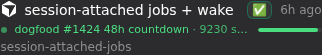
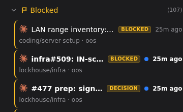

# DRAFT — upstream submission, for operator approval before anything is posted

**Target:** `tiann/hapi`, as one issue that the coordinated PRs each link back to.
**Constraint:** short enough to actually be read by a solo maintainer. Current draft ≈ 450 words.
**Status:** NOT POSTED. Nothing has been opened upstream.

---

## Session attention after `832c5922f` — a coordinated proposal

`832c5922f` reworked the session row: the residency fade was removed and liveness moved to a
dot on the agent icon. I run HAPI with a fleet of over 1,000 sessions, of which at least ~30 are
active at any one time, and have been dogfooding an attention model against that load for several
months. This issue sets out what I've found, so the PRs that follow read as one design rather than
scattered changes.

**Three things a session row has to answer, at a glance:**

1. **What is it doing?** — working, background work, idle.
2. **Is it resident?** — is a runner holding this session in memory.
3. **What does it need from me, and why?** — and this is the one that matters at scale.

**I understand the change on (1)** — green for working, blue for background. Fine.

**(2) regressed, and I'd like to make the case for restoring it.** Before `832c5922f` a
non-resident row was faded. At a handful of sessions a 10px dot is fine; at thirty-plus active
inside a thousand-session fleet, residency is a whole-list scan, and only a row-level signal
survives it. Fade means residency: faded sessions are not taking RAM. Operators already know how
to read that, and it means something important.

**A note on the signal itself.** `AGENT_NOTIFY_SUMMARY` already exists upstream. It has been
quietly accumulating on installs that emit it — time to put it to use. Today it lands in the
work-graph ledger but never on the session list, and emission sits behind an off-by-default
toggle. The blocked affordance below is the consumer that makes that latent signal visible.

**(3) is where most of my work has gone, and it is not a chrome problem.** A session should be
able to say what it is blocked on, in its own words, and the list should surface that. I persist
the agent's last end-of-turn status footer and drive a blocked section, a per-row rail, an
off-viewport jump counter, and a "mark unblocked" flow that records a reason. Four fixes in my
tree exist purely to make that signal *fire correctly* — the chrome was the easy part. I'd rather
land the producer side than a prettier badge.

**What follows, in order** — each PR links back here:

| # | Scope |
|---|---|
| 1 | Session-attached jobs — work that outlives the agent, with list chrome *(already open)* |
| 2 | Blocked affordance: section, rail, jump pill, mark-unblocked with recorded reason |
| 3 | Hub-authored blocker sources for terminal agent errors *(extends 2)* |
| 4 | Residency: restore the row-level fade alongside your dot |
| 5 | Settings: "Flag blocked sessions from status summaries", below the existing emit toggle |
| 6 | First-use introduction for the blocked affordance, on the existing FUE primitives |
| 7 | Discovery callouts for three shipped-but-unlabelled controls: content-search scope, sort/filter menu, title lock |

These are not proposals from theory. Every one has been running live on that fleet — the blocked
affordance since the issue was filed. I am moving ahead with the dogfooding process on each PR
(`dogfooded` label, 48h UTC). If that should not happen, remove the label on that PR, per the
announced practice in [Discussion #2083](https://github.com/tiann/hapi/discussions/2083). The
order above is a real dependency chain, so a removal part way down just stops everything after it.

---

## Notes for the operator (not for upstream)

- **Voice:** first person ("I"), matching public GitHub voice. No royal-we.
- **Axes reordered (operator, 2026-11-09):** (1) activity → (2) residency → (3) needs-from-me.
  Activity paragraph is "I understand / fine", not "please adopt as-is" — the maintainer already
  shipped it.
- **Long-running-job fade digression removed.** Point of residency is: fade = not taking RAM;
  operators already know that signal. Job chrome is its own item.
- **Cursor "no system-prompt seam" claim deleted from the upstream body — and stay precise.**
  Live hub DB (`/var/lib/hapi/hapi.db`, 2026-11-09): **542 / 892** Cursor sessions have
  `last_notify_status` populated. That beats the upstream code comment Meta relayed. **Both can
  be true:** unmodified upstream may still lack a Cursor system-prompt seam; *our* fleet
  self-reports because emission was arranged via `feat/overseer-summary-emit` (transient
  `.cursor` rule overlay; manifest: **"fork-only (PR #86/#87, DO NOT upstream)"**). Upstream
  body wording ("emission was arranged") is the right shape — do **not** let it drift into
  implying a vanilla install gets the same Cursor coverage. If a maintainer enables the setting
  and finds Cursor silently dark, that is a trust cost we manufactured. PR 3 stays as hub
  speaking for *terminal* agent errors / dead turns, not as a Cursor hole-filler.
- **Fleet framing:** "over 1,000 sessions, ≥~30 active at a time" — not "30-session fleet".
  Live list chrome in the blocked shot shows All (1280).
- **Inline images (operator ask, refreshed 2026-11-09 dark mode):** light-mode pinned-section
  shots discarded. New crops from live `:3006` with `hapi-appearance=dark`:
  - item 1 = `assets/session-attention-attached-job.png` — session-attached jobs row with live
    countdown meter (`6e70f97b…`, `/tmp/attention-dark-shots/attached-job-row-dark.png`)
  - item 2 = `assets/session-attention-blocked-row.png` — Blocked section (107) with natural
    BLOCKED / DECISION rows, no pinned chrome (`blocked-section-multi-dark.png`)
  - extras on disk: jump pill, single-row blocked crop. For the GitHub issue body, upload these
  rather than relying on repo-relative `assets/` paths.
- **Omitted deliberately:** any reference to `#2296`. Arguing against a live contributor's PR in
  our own submission would be poor form, and the case stands on its own without it. If the
  maintainer raises it, answer then. (Do not @-mention anyone in the posted body — fires the
  broken `codex-mention-response.yml`.)
- **"Take the green notion"** is reflected as understanding (1), not as a request.
- **Dependency reality:** 3 extends 2's enum and cannot precede it; 1 is already open as #1424.
  The order above is real, not cosmetic.
- **Resolved:** `sessions.last_notify_*` is **not** fork-only-dependent. `AGENT_NOTIFY_SUMMARY` is
  an existing upstream convention already parsed by `workGraphNotifyIngest.ts`; what's missing is
  any session-row field, which PR 2 adds itself. Verified with a working positive control (field
  in 8 hub files on soup, 0 in the same files on `upstream/main`).
- **The dogfood close asserts the process, not a hedge.** Wording: move ahead with dogfooding;
  remove the label to stop it; cite Discussion #2083 where the practice was announced. Label
  description on `tiann/hapi`: *"Live dogfood by write collaborator; 48h UTC opt-out then merge
  intent."* `docs/operator/AGENTS.md` gate check 8/9 matches: elapsed 48h UTC with the label
  still present is lane B auth.
- **New item 5 (operator, 2026-11-09):** a second settings affordance directly below *"Emit status
  summaries"* — flag sessions as blocked according to those summaries — **on by default**, opt-out.
  It is strictly downstream of the emit toggle: with emission off there is nothing to flag.
- **Item 6, FUE (operator, 2026-11-09):** blocked status is new chrome appearing unprompted —
  especially once item 5 defaults on — so it needs a first-use introduction.
  **Constraint, checked.** Upstream **already has** the ordinary FUE (`web/src/components/Fue.tsx`,
  `web/src/lib/use-fue.ts` both on `upstream/main`). That is what item 6 should use.
  What is *not* on upstream main is the guided-tour / FUE v2 work in
  `feat/fue-app-shell-onboarding` (aimed at open issue #1272 with no PR raised). Do not couple
  item 6 to that unfiled PR.
- **Default-on: operator decision, taken with the objection on the table.** Raised that flipping
  an off-by-default toggle changes behaviour for every existing user; operator's position is that
  these summaries *should* be emitted every time and that the point is to start taking advantage
  of them. Proceed default-on. Flag the default change honestly in the PR body for item 5 — it is
  the biggest ask in the set.
- **Item 7 placement — operator call, 2026-11-09, against Meta's recommendation.** Three discovery
  callouts stay inside the umbrella. Connective tissue: finding and narrowing sessions is the
  same attention-management surface as knowing which ones need you. Coverage asymmetry for the
  PR body: two of three controls verified live; title-lock is unit-test-only against clean
  `upstream/main` (soup lost that control — heavygee/hapi#312).
- **Merging is still operator/Meta, never an agent.** `hapi-laneb-authorise` refuses to run from
  any agent shell by design and has no bypass. The announcement commits *you* to the merges —
  prepare, chip and verify only.
